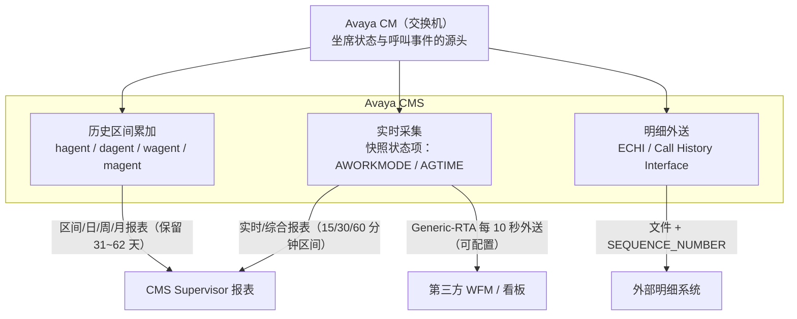

# Avaya 坐席事件处理机制调研报告

> 定位：调研 Avaya 官方文档、知识库与官方博客中关于坐席状态事件处理、时间窗口累加与话务统计的实现机制，作为「坐席事件推送处理系统」（Java 21 + Redis，接收通话开始/结束、休息开始/结束、整理态开始等事件，累计状态时间窗口并实时输出话务指标）的架构参考。报告最后给出 Avaya 机制与本系统实现的逐项映射及差距分析。

## 1. 摘要

Avaya 在坐席事件处理上沉淀了三十余年的工程经验，其做法可归纳为四条核心原则：

1. **实时链路：快照优先于事件重放。** 实时数据由「当前状态快照 + 状态计时器」派生（`AWORKMODE` / `AGTIME` 状态项），查询者在任意时刻读到一致快照，事件到达顺序完全不影响结果 [cite:6][cite:7][cite:8]。AES/TSAPI/DMCC/JTAPI 甚至不提供坐席状态变化事件，官方明确要求应用轮询查询 [cite:13]。
2. **历史链路：固定区间累加 + 双归属口径。** 数据按 intrahour 区间（15/30/60 分钟）累加进 `hagent`/`dagent`/`wagent`/`magent` 等分层表 [cite:10][cite:12]，并区分「状态发生区间」（`I_ACWTIME` 等 `I_*` 项）与「呼叫关联区间」（通话结束所在区间，`ACWTIME`、话务量）两种口径 [cite:9]。
3. **明细链路：序号用于重传去重，排序依赖业务时间戳。** ECHI 以文件级 `SEQUENCE_NUMBER`（4 字节，回绕归零）识别重传重复 [cite:1]；段排序唯一可靠依据是 `SEGSTART`，`SEGMENT` 字段官方明确不可信，且两段可能共享同一 `SEGSTART`（官方承认的固有歧义）[cite:2]。
4. **时钟单一权威。** CMS 数据时间戳取自生成数据的本地交换机时钟，跨时区仅在显示层调整 [cite:20]。

乱序问题在 Avaya 生态被视为必然：第三方集成商 Genesys 曾修复其 TSAPI 事件「按定时器分发导致乱序、进而产生错误呼叫模型」的缺陷 [cite:17]；Avaya 自家 Analytics 也发生过缓存腐化导致坐席卡死在 "Voice Call" 状态的事故 [cite:19]。因此 Avaya 的架构取向不是「消灭乱序」，而是「让乱序无害」。

## 2. 总体架构：三条数据链路

Avaya Call Management System（CMS）是构建在 Communication Manager（CM）ACD 功能之上的报表与管理平台，运行于 RHEL，使用 Informix 作为历史数据库 [cite:21]。其数据流分为三条相互独立的链路，各链路对可靠性的设计目标不同：

### 2.1 实时链路：状态快照 + 派生计时器

实时报表显示当前 intrahour 区间（15/30/60 分钟），随数据变化周期刷新；综合（Integrated）报表实时累计过去 24 小时 [cite:11]。实时数据库的核心是两个**状态项（status item）**：

- **`AWORKMODE`**：坐席当前工作模式。与全局 `WORKMODE` 的差别在于按 split/skill 判定——坐席仅在某个技能可用时，该技能记录才置为 `AVAIL`，否则置为 `OTHER` [cite:7]。
- **`AGTIME`**：自最近一次坐席 WORKMODE 变更起的经过时间。方向（`DIRECTION`）变化不重置；`AUX → AUXOUT → AUX` 连续累计、不重置 [cite:6]。

CMS Supervisor 的「坐席图形信息报表」中，State 即 `syn(AWORKMODE) + syn(DIRECTION)`，Time 即 `AGTIME` [cite:8]。**这条链路里根本不存在「事件流」——状态是现值，时长是 `now - enterTime` 的派生值**，因此乱序、丢失、重复事件对实时显示不构成威胁。

需要向外部系统推送时，采用**定时批量**而非逐事件推送：Generic-RTA 接口每 10 秒（可配置）将坐席工作模式变化外送给 WFM 系统 [cite:16]。

### 2.2 历史链路：分层区间累加

历史数据按 ACD 元素（split/skill、agent、trunk、VDN 等）与时间跨度组织为 54 张表 [cite:22]，ODBC 可访问的坐席/技能表按时间粒度分层：`hagent`（每小时段内区间）、`dagent`（日汇总）、`wagent`（周）、`magent`（月），技能表同理 [cite:10]。历史报表分 Interval / Daily / Weekly / Monthly 四类，区间数据通常保留 31 天、最多 62 天 [cite:12]。第三方 WFM（如 NICE）对接 CMS 时同样按 15 分钟区间消费实时与历史两类数据 [cite:25]。

### 2.3 明细链路：ECHI / Call History Interface

ECHI（External Call History Interface）将 CMS 呼叫记录传送到外部计算机做进一步处理，面向高话务量呼叫中心 [cite:1]。一个关键的所有权设计：**一旦安装启用 ECHI，CMS 自身即不再保留呼叫记录数据，Call Record 报表随之不可用** [cite:3]，新版维护文档同样强调这一点 [cite:24]。明细数据只有单一所有权方，从源头避免双源不一致。现行版本文档已更名为 CMS Call History Interface（R19.2，2021 年版）[cite:4]。

## 3. 坐席状态机：WORKMODE 模型

### 3.1 状态全集与语义

官方《Administering CMS》定义的坐席工作模式全集 [cite:5]：

| 模式 | 语义 | 本系统事件对应 |
|---|---|---|
| `ACD` | 正在处理 ACD 呼叫 | 通话开始 → 通话结束 |
| `ACW` | 话后处理（整理态） | 整理态开始 |
| `AUX` | 辅助工作/不可用，可带 reason code | 休息开始 |
| `AVAIL` | 可接 ACD 呼叫 | （空闲态） |
| `DACD` / `DACW` | 直接坐席呼叫的通话/话后处理 | （非 ACD 呼叫） |
| `OTHER` | 刚登录 CMS 尚未获知状态；AI/MI 下拨分机或振铃；呼叫保持中且无其他动作 | （复合态） |
| `RINGING` | ACD 呼振铃中 | （振铃态） |
| `UNKNOWN` | CMS 无法识别当前状态 | （防御态） |
| `UNSTAFF` | 未登录或未排班 | （登出态） |

AUX 工作模式支持 reason code（休息原因细分），坐席在通话中申请 AUX 时，CM 接受请求但置为 pending，直到通话放下才真正生效并通知 [cite:23]——**状态转移的生效时刻是「实际可生效时刻」，而非「请求时刻」**，事件时间必须取状态真实翻转时刻。

### 3.2 同族状态不重置计时器

`AGTIME` 的官方语义是最有参考价值的细节：`AUX → AUXOUT → AUX` 的往返**不重置**、连续计时；方向变化也不重置 [cite:6]。即：同一族内的子状态切换（休息中接外线再回到休息）在「本状态时长」维度上被视为连续状态。本系统「同状态转移不切分窗口、callCount 不重复」的裁决与该语义一致。

### 3.3 防御性状态：承认「不知道」

`OTHER` / `UNKNOWN` / `UNSTAFF` 的存在表明：官方状态机必须能表达「系统尚未获知」与「无法识别」，而不是假装一切正常 [cite:5]。本系统中 `prevState` 可为空的设计与之对应——首个事件到达前，坐席状态就是未知的。

## 4. 时间窗口累加的官方口径

### 4.1 双口径：状态发生 vs 呼叫关联

Avaya 官方博客对「ACD 呼数 × 平均 ACW 时间 ≠ 总 ACW 时间」这一著名现象的完整解释 [cite:9]：

| 口径 | 数据项 | 归属区间 | 统计内容 |
|---|---|---|---|
| 呼叫关联 | `ACWTIME` | **ACW 结束**所在的区间 | 仅与 ACD 呼相关的话后处理 |
| 状态发生 | `I_ACWTIME` | **状态发生**所在的区间 | 区间内处于 ACW 模式的全部时长（含无呼叫的 ACW，即坐席主动按 ACW 键） |
| 呼叫关联 | `ACD 呼数` | ACW 结束所在区间 | 例：10:30 进入 ACW、11:00 结束 → 呼叫计入 11:00 区间 |
| 状态发生 | `I_ACDTIME` | 通话发生所在区间 | 与 `ACDTIME` 同理 [cite:9] |

因此「ACD 呼数 × 平均 ACW ≠ 总 ACW」是设计使然而非缺陷：平均口径用呼叫关联项，总量口径用状态发生项。`I_*` 系列在数据库中均为**累计项（cumulative item）** [cite:26]。

### 4.2 本系统对照

本系统窗口以 `enterTime` 为起点累计、跨零点拆分、进行中窗口以 `live` 补充——这属于「状态发生（`I_*`）」口径。建议在接口文档中**显式声明口径**；若将来需要「通话时长按通话结束归属」「话务量按 ACW 结束区间计入」等呼叫关联报表，应作为派生口径另行实现，避免混用。

### 4.3 多维归属的确定性

多技能环境中，坐席按 ACW 键产生的时间统计到其 TOP（第一个注册）技能 [cite:9]。启示：一个状态时长只能归属一个主维度，多技能/多项目场景必须选定确定性的主归属维度，防止双计。

## 5. ECHI 明细流的可靠性设计

### 5.1 文件级 SEQUENCE_NUMBER

R13 ECHI 官方文档原文 [cite:1]：

> The SEQUENCE_NUMBER field is a 4-byte Integer. The SEQUENCE_NUMBER field identifies a particular call record file so that duplicates can be recognized when retransmission has occurred. These files are sequential. The SEQUENCE_NUMBER restarts at zero when its 4-byte integer reaches its limit.

三个要点：

1. **序号是文件级**而非单条事件级，消费端以文件为单位追踪进度；
2. **序号的法定用途是重传去重**——Avaya 明说传输层会发生重传，序号的存在就是为了识别重传产生的重复；
3. **回绕是官方语义**——4 字节计满（全 1）后归零重新开始，消费端必须支持。

### 5.2 段排序：SEGSTART 唯一可靠

Avaya 知识库 SOLN310627（官方答复，结论为 Working as design）[cite:2]：

- `SEGMENT` 字段的值**不总按呼叫进程顺序**出现（实例：先接的呼叫是 segment 2、保持中拨出的呼叫反而是 segment 1）；
- 多数情况下 1 表示第一段，但**不可依赖**；
- 唯一可靠方法是按 `SEGSTART`（段开始的 UNIX 时间戳）排序 [cite:1]；
- **两段可能具有相同的 `SEGSTART`**，此时无法判定先后——官方承认该固有歧义，实际呼叫中心中极少发生。

这展示了 Avaya 在明细层面的务实取舍：**不维护复杂的重排序缓冲，而是「序号去重 + 业务时间戳排序 + 接受极小概率的并列歧义」**。

### 5.3 明细数据单一所有权

启用 ECHI 后 CMS 自身不再保留呼叫记录 [cite:3][cite:24]。系统间传递明细时保持单一出口、单一所有权方，是避免双源不一致的结构性手段。

## 6. 实时状态「查询而非订阅」的哲学

### 6.1 官方立场：没有坐席状态变化事件

Avaya 支持论坛的官方答复 [cite:13]：

> AE Services does not provide Agent State Change events. Applications must poll for the current state of an agent. … This is the same as it is in DMCC, JTAPI and TSAPI.

配套的 PSN020283 文档专门指导「轮询坐席状态」的实现。DMCC 提供 `GetAgentState` 查询（响应含 `workMode`、`talkState`、`reasonCode`）[cite:15]；CSTA 的 Snapshot Services 提供设备参与呼叫的第三方快照（设备、连接与本地连接状态）[cite:14]。

### 6.2 为什么：查询/快照对乱序与丢失天然免疫

- 状态查询返回的是**当前时刻的完整快照**，不存在「漏掉某次中间转移」的问题；
- 若两次轮询间发生多次转移，损失只是中间态的时长精度，不会造成状态机错乱；
- 配合 `AGTIME`（自最近转移起的时长），客户端还能计算「上一状态的剩余时长」，近似还原转移时刻。

对比之下，事件订阅流必须自行解决：乱序（见 Genesys 修复的 TSAPI 事件定时乱序导致错误呼叫模型 [cite:17]）、丢失（需要快照/重同步兜底）、重复（需要序号去重）。Avaya 的选择是：**能用快照解决的场景绝不引入事件流**。

### 6.3 防御性交互：设置前先查询

坐席正通话时执行 Set Agent State 会得到 `RESOURCE_BUSY`，官方建议**先查询坐席状态再设置** [cite:18]。这种「先读后写」的防御风格贯穿其 API 设计。

### 6.4 推送场景的折中：定时批量

确需主动推送给第三方时（WFM 类系统），采用 Generic-RTA 式定时批量外送（每 10 秒，可配置）[cite:16]——牺牲秒级实时性，换取天然的去重/乱序免疫（每批都是快照增量，可整体覆盖）。

## 7. 时钟权威与时间戳策略

官方手册明确：**CMS 数据的时间戳取自生成数据的本地交换机时钟**；当 CMS 纳管跨时区 ACD 时，时区差异仅在 CMS Supervisor 显示层调整，底层存储保持交换机原始时间 [cite:20]。原则：

- 事件时间以**事件源时钟**为唯一权威，入库链路不混用接收方时钟；
- 接收方时钟只用于自己的运维监控（如乱序检测），不参与统计归属。

本系统「未来时间拒绝（>300s 偏差）+ 释放去重键允许修正重推」是该原则的防御性补充，方向一致。

## 8. Avaya 机制与本系统实现的映射及差距分析

### 8.1 已对齐项

| 可靠性关切 | Avaya 做法 | 本系统现状（commit 647d759） | 依据 |
|---|---|---|---|
| 重复/重放事件 | 文件级 `SEQUENCE_NUMBER` 识别重传重复 [cite:1] | `eventId` SET NX EX 去重 + 可选 `seq` 严格单调校验（过旧返回 200/SEQ_TOO_OLD） | ECHI |
| 乱序事件 | 不依赖到达顺序：快照体系 [cite:6][cite:8]、明细按 `SEGSTART` 排序 [cite:2] | `eventTime < enterTime` 的事件不闭合窗口、不倒退状态机、不重置 `enterTime`，仅记录 lastEventType/lastEventTime | CMS 实时模型 |
| 同族状态往返 | `AUX→AUXOUT→AUX` 计时连续不重置 [cite:6] | 同状态转移 `sameState=1`：不切分窗口、不重复计数、`enterTime` 不变 | AGTIME |
| 时钟偏差 | 事件源时钟为唯一权威 [cite:20] | `eventTime` 超前服务器 >300s 拒绝 400 并释放去重键，允许修正重推 | 时间戳策略 |
| 「不知道」的表达 | `OTHER`/`UNKNOWN` 防御状态 [cite:5] | 首事件前 `prevState` 为空，拒绝在未知态上做归因 | 状态机 |
| 状态僵尸 | （无 TTL，靠巡检；仍有卡死事故 [cite:19]） | 状态 hash 7 天 TTL，每次事件续期 | 事故教训 |
| 话务量精确计数 | 呼叫关联口径显式区分 [cite:9] | 仅真正从非 IN_CALL 转入 IN_CALL 时 `callCount+1` | 双口径 |
| 修正重推协议 | 设置前查询的防御风格 [cite:18] | 400 后去重键释放，同一 eventId 可修正重推 | 防御交互 |

### 8.2 差距与增强建议（按优先级）

1. **事件审计落库（高）**。当前系统无任何持久化层，原始事件与裁决结果（`ignored` / `outOfOrder` / `prevState` / `newState`）仅存在于响应中，无法事后对账。参考 Avaya「明细（ECHI）+ 分层区间（hagent/dagent）」双轨 [cite:1][cite:10]：建议将每条事件连同 Lua 裁决结果写入可持久化存储（文件/表均可，不引入第三方中间件的前提下可用 Redis Stream 或追加日志文件）。
2. **快照对账与重放重建（高）**。有了事件落库后，可实现周期对账：重放当日事件重建窗口并与 Redis 实时值比对，偏差即告警。这正是「查询而非订阅」哲学的对账形态——**实时值永远可由明细重建** [cite:13][cite:14]。
3. **seq 回绕语义（中）**。Avaya 明确 4 字节回绕归零是合法状态 [cite:1]；本系统 `seq <= lastEventSeq` 一律拒绝，不支持回绕。建议：支持回绕窗口（当 `seq` 远小于 `lastSeq` 且间距接近 2^32 时视为回绕并接受），或在接口文档明确「序列号不回绕、重启需清零上报」的约束。
4. **统计口径声明（中）**。在接口文档显式声明本系统为「状态发生（`I_*`）口径」，时长归属状态发生所在日/窗口；如需「呼叫关联口径」（通话按结束时刻归属、话务量按 ACW 结束区间计入 [cite:9]）作为派生报表另行实现。
5. **卡死状态巡检（中）**。TTL 只是兜底；Avaya 自家仍有坐席卡死事故 [cite:19]。建议增加周期巡检：`updatedAt` 超过阈值（如 30 分钟）的坐席状态产生告警，联动人工核实。
6. **推送消费端契约（低）**。对外输出（若未来提供 Webhook）参考 Generic-RTA 定时批量快照风格 [cite:16]，而非逐事件流；若必须逐事件，遵循 Avaya 的消费者契约：`seq` 去重、业务时间戳排序、并列歧义接受。

## 9. 结论

Avaya 的可靠性来自架构取向而非算法复杂度，可迁移为四条原则：

1. **快照优先于事件重放**——实时值 = 现状 + 派生计时器，让乱序无害；
2. **序号用于重传去重，排序以业务时间戳兜底**——`SEQUENCE_NUMBER` 管去重，`SEGSTART` 管排序，两者职责分离；
3. **统计口径双轨明确**——状态发生口径与呼叫关联口径分开存储、分开声明；
4. **时钟单一权威**——事件源时钟管归属，接收方时钟只管运维。

本系统已覆盖 Avaya 的核心语义（去重、单调序号、乱序不倒退、同态不切分、时钟偏差防护、TTL 兜底、精确话务量），差距集中在**可观测性**（事件审计落库、对账重放、卡死巡检）与**协议完备性**（seq 回绕、口径声明）两个层面，均已给出可落地的增强路径。

## Sources

[cite:1] Avaya Call Management System Release 13 External Call History Interface (07-300737) — https://support.avaya.com/elmodocs2/cms_r13_1/07-300737_ECHI.pdf

[cite:2] Avaya Knowledge SOLN310627 — CMS Call segment questions（SEGMENT 字段不可信、按 SEGSTART 排序）— https://support.avaya.com/public/index?page=content&id=SOLN310627

[cite:3] Avaya Knowledge ADMN115041 — CMS R13/R18 安装启用 ECHI（启用后 CMS 不再保留呼叫记录）— https://support.avaya.com/public/index?page=content&id=ADMN115041

[cite:4] Avaya CMS Call History Interface Release 19.2（2021）— https://support.avaya.com/public/downloadFile.jsp?file=/resources/sites/AVAYA/content/live/SOLUTIONS/310000/SOLN310627/en_US/Avaya_CMS_Call_History_Interface_19.2_March_2021.pdf

[cite:5] Administering Avaya CMS R21 — Agent string value descriptions（工作模式全集）— https://documentation.avaya.com/ja-jp/home/bundle/cms/AdministeringCMS_r21/UsingTheDictionaryToNameContactCenterEntities/AgentStringValues/AgentStringValueFieldDescriptions.html

[cite:6] CMS Database Items and Calculations R21 — AGTIME (real-time)（AUX→AUXOUT→AUX 不重置）— https://documentation.avaya.com/en-us/home/bundle/cms/AvayaCMSDBItemsCalculations_r21/DictionaryOfCMSDatabaseItems/AgtimeReal_Time.html

[cite:7] CMS Database Items and Calculations R21 — AWORKMODE (real-time)（按 split 判定 AVAIL/OTHER）— https://documentation.avaya.com/pt-br/bundle/AvayaCMSDBItemsCalculations_r21/DictionaryOfCMSDatabaseItems/AworkmodeReal_Time.html

[cite:8] CMS Supervisor Reports R21 — Agent Graphical Information report description（State/Time 的派生公式）— https://documentation.avaya.com/en-us/home/bundle/cms/AvayaCMSSupervisorReports_r21/IntegratedReports/IntegratedAgentReports/AgentGraphicalInformationReport/AgentGraphicalInformationReportDescription.html

[cite:9] Avaya 官方博客（Avaya Japan）第 14 回「CMSの謎を解け ― その1」（ACWTIME 与 I_ACWTIME 双口径、区间归属、TOP 技能）— https://www.avaya.com/jp/blogs/blog-solved-cms-mystery-part1-14/

[cite:10] Avaya Knowledge ADMN114879 — CMS ODBC 表清单（hagent/dagent/wagent/magent 等）— https://support.avaya.com/public/index?page=content&id=ADMN114879

[cite:11] Avaya CMS Supervisor R14 Report Designer（实时/综合/历史报表与 intrahour 区间）— https://support.avaya.com/elmodocs2/cms/R14/RepDesign.pdf

[cite:12] Avaya CMS Web Supervisor R18 Workbook（Johns Hopkins IT，Interval/Daily/Weekly/Monthly 与保留期）— https://it.johnshopkins.edu/wp-content/uploads/2021/07/Avaya-CMS-Web-Supervisor-R18-Workbook.pdf

[cite:13] Avaya Support Forums — In-house CTI Application not receiving agent state changes（官方答复：无坐席状态变化事件，须轮询；DMCC/JTAPI/TSAPI 皆然）— https://support.avaya.com/forums/forum/api-developer-forums/avaya-aura-application-enablement-services-apis/web-services/48779-in-house-cti-application-not-receiving-agent-state-changes-from-wti

[cite:14] Avaya AES Device, Media and Call Control API XML Programmer's Guide R4.1 — Snapshot Services — https://support.avaya.com/elmodocs2/AES/4.1/02_300358_i3.pdf

[cite:15] DMCC API Javadoc — Serialized Form（GetAgentStateResponse：workMode/talkState/reasonCode）— https://support.avaya.com/elmodocs2/AES/4.2/javadoc/avaya-xml/serialized-form.html

[cite:16] Application Notes — P&W Solutions Sweet Series with Avaya CMS using Generic-RTA（每 10 秒外送，可配置）— https://www.pw-s.com/pdf/ApplicationNote_CMS-Sweet-RTA_100525.pdf

[cite:17] Genesys T-Server for Avaya TSAPI 8.1.x Release Note（修复事件按定时器分发导致乱序、产生错误呼叫模型）— https://docs.genesys.com/extensions/Repository/backup/backup_0.0.8_avaya-tsapi81rn.html

[cite:18] Avaya Knowledge SOLN363215 — RESOURCE_BUSY on Set Agent State（先查询坐席状态再设置）— https://support.avaya.com/public/index?page=content&id=SOLN363215

[cite:19] Avaya Knowledge SOLN384711 — Analytics 坐席卡死在 "Voice Call" 状态（缓存腐化）— https://support.avaya.com/public/index?page=content&id=SOLN384711

[cite:20] Avaya Communication Manager Contact Center 手册 — Setting up ACD offset times for CMS reporting（时间戳取自本地交换机）— https://www.manualslib.com/manual/536691/Avaya-Communication-Manager-Contact-Center.html?page=367

[cite:21] Administering Avaya CMS R21 — CMS overview（平台与 Informix 历史库）— https://documentation.avaya.com/ko-kr/home/bundle/cms/AdministeringCMS_r21/WhatIsAvayaCMS.html

[cite:22] Avaya CMS Custom Reports Issue 3.1（54 张表按元素与时间跨度组织）— https://support.avaya.com/elmodocs2/multivantage/215822_3/215822_3_1_CMS_Reports.pdf

[cite:23] Using Avaya Call Center Elite — 96x1 SIP Agent Deskphones（AUX 申请在通话中为 pending，放下后才生效）— https://documentation.avaya.com/en-us/home/bundle/call-center-elite/cceliteusing96x1sipagentdeskphonesr102x/Avaya96X1SIPAgentDeskphones/AboutBasicLoginLogoutAndWorkModeChanges.html

[cite:24] Maintaining and Troubleshooting Avaya CMS R21（ECHI 安装后 CMS 不再直接访问呼叫记录）— https://documentation.avaya.com/content/dam/docs/en-us/pdfs/book-lite/general/contact-center---performance-solutions/cms/maintaining-and-troubleshooting/publications/maintainingandtroubleshooting_r21/Maintaining_and_Troubleshooting_Avaya_CMS.pdf

[cite:25] NICE CXone WFM — Avaya CMS 连接器（15 分钟区间、实时状态 + 历史数据双用途）— https://help.nicecxone.com/nl/content/workforcemanagement/avayacms.htm

[cite:26] CMS Database Items and Calculations R21 — I_DA_ACWTIME（区间累计项示例）— https://documentation.avaya.com/en-us/home/bundle/cms/AvayaCMSDBItemsCalculations_r21/DictionaryOfCMSDatabaseItems/IDAACWTIME.html
